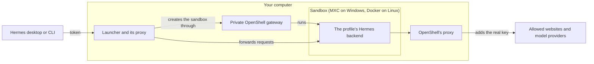

# OpenShell sandbox plugin for Hermes Agent

The `openshell` plugin runs one Hermes profile's backend inside an
[NVIDIA OpenShell](https://github.com/ai-openshell/openshell) sandbox.
You turn the sandbox on and off per profile, from the desktop's Sandbox page or from a terminal.

While it is on, the profile's chats, tools and terminal run in the sandbox.
The sandbox reaches only the folders and websites you allowed.

## Status

The plugin is in beta. Its limits and open problems are in [Known issues](docs/known-issues.md).

| Platform | Isolation | Status |
|---|---|---|
| Windows 11 x64 | Microsoft MXC process containers | Tested |
| Windows 11 on Arm64 | Microsoft MXC process containers | Not yet run on hardware |
| Linux x86_64 | Docker | Tested on Ubuntu 26.04, and on Ubuntu 24.04 in WSL2 |
| Linux aarch64 | Docker | Built, not yet run on hardware |
| macOS | | Not supported |

## Requirements

- **Windows:** Windows 11 24H2 or newer with the September 2026 update. See
  [Set up Windows](docs/setup-windows.md).
- **Linux:** x86_64 or aarch64 with glibc, Linux 6.2 or newer, Docker and a systemd user session.
  See [Set up Linux](docs/setup-linux.md).
- **Hermes:** a build that has the sandbox support. See
  [Get a Hermes build](docs/install.md#get-a-hermes-build-with-sandbox-support).
- **A profile** other than the default one, with a model whose context is at least 64K tokens.

## Quickstart

1. Get the Hermes build and finish the setup for your system: [Install](docs/install.md).
2. Create a profile, install the plugin and OpenShell for it, and check the computer:

   ```bash
   hermes profile create sbtest --clone
   ref=$(git ls-remote https://github.com/NousResearch/hermes-nvidia refs/heads/feat/openshell | cut -f1)
   hermes -p sbtest plugins install NousResearch/hermes-nvidia/openshell --ref "$ref" --enable
   hermes -p sbtest sandbox runtime install
   hermes -p sbtest sandbox check
   ```

3. Turn the sandbox on, look at it, and turn it off:

   ```bash
   hermes -p sbtest sandbox on
   hermes -p sbtest sandbox status
   hermes -p sbtest sandbox off
   ```

Step 2 in PowerShell is in [Install the plugin](docs/install.md#install-the-plugin).
For the desktop's Sandbox page, also
[turn on the plugin in the desktop](docs/install.md#turn-on-the-plugin-in-the-desktop).
Then follow [Use the sandbox](docs/using.md).

## How it works



- A launcher (`hermes sandbox serve`) runs on the host as a login service and starts the sandbox.
- The desktop talks to the launcher's proxy on a loopback port. The proxy checks a token first.
- Keys and sign-in tokens stay on the host. The sandbox holds placeholders, and OpenShell's proxy
  puts the real key into a request only when the request goes to the key's own address.
- A folder or website you did not allow is refused. A refusal during a chat raises a card with
  **Allow**, **Always allow** and **Deny**.

More in [How it works](docs/how-it-works.md).

## Documentation

| Page | What it is for |
|---|---|
| [Install](docs/install.md) | Get the Hermes build, install the plugin, check, update, uninstall |
| [Set up Windows](docs/setup-windows.md) | Windows version, MXC and the sandbox's shell |
| [Set up Linux](docs/setup-linux.md) | Kernel, Docker and the systemd user session |
| [Use the sandbox](docs/using.md) | Turn it on and off, add folders, allow websites |
| [Approval cards](docs/cards.md) | Answer the sandbox's questions in a chat |
| [Review changes at switch-off](docs/switching-off.md) | What the sandbox changed, Revert and Keep |
| [API keys and providers](docs/credentials.md) | Which keys and providers work, what keeps the switch off |
| [Provider sign-ins](docs/sign-ins.md) | How a signed-in provider works in the sandbox |
| [Sign-in renewal](docs/sign-in-renewal.md) | How sign-ins are renewed, and what happens when one ends |
| [Programs inside the sandbox](docs/inside-the-sandbox.md) | What differs for curl, git, Python and the shell |
| [Activity log](docs/activity-log.md) | The Activity tab, its sources and the OCSF export |
| [Command reference](docs/cli.md) | Every `hermes sandbox` command, flag and exit status |
| [How it works](docs/how-it-works.md) | Launcher, gateway, drivers, proxy and host-only state |
| [Security](docs/security.md) | What the sandbox protects, what it does not, telemetry |
| [Troubleshooting](docs/troubleshooting.md) | Refusals, logs, reporting a problem |
| [Known issues](docs/known-issues.md) | Limits and open problems in this beta |
| [Beta testing](docs/beta-testing.md) | What testers should try and how to report |
| [Development](docs/development.md) | Code layout, tests, changing a pin |

## Tests

Run the suite from the repository root with the Python environment of a Hermes checkout:

```bash
PYTHONPATH="<hermes checkout>:<this repository>" <hermes python> -m pytest openshell/tests -q -p no:cacheprovider
```

On Windows the path separator is `;`. See [Development](docs/development.md#run-the-tests).

## License

MIT, as [`plugin.yaml`](plugin.yaml) declares.
